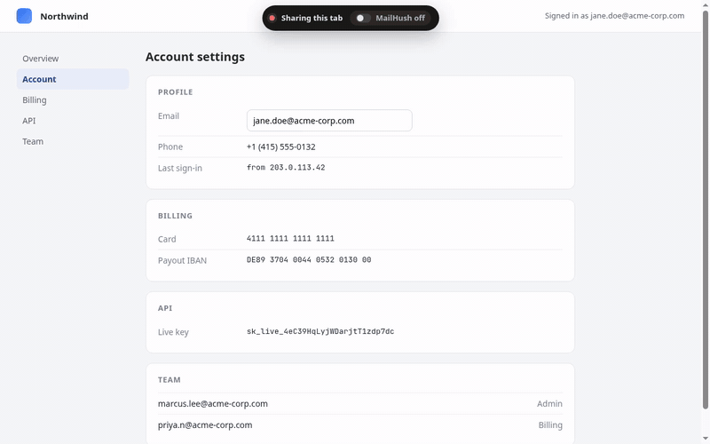

# MailHush

Email addresses exposed in web applications can accidentally appear in screenshots, streams, and screen shares. MailHush is a browser extension that replaces configured addresses—and, optionally, other email-like text—in the rendered page DOM while preserving surrounding styling.



**Status:** Published on [Firefox Add-ons](https://addons.mozilla.org/en-US/firefox/addon/mailhush/) and packaged for Chromium and Firefox in [GitHub Releases](https://github.com/pc-style/mailhush/releases/latest). The Chrome Web Store listing is not available. No support or maintenance commitment is promised.

**License:** No license has been granted for this repository. The source is publicly visible, but default copyright restrictions apply; public availability does not mean open source.

**Provenance:** The commit history records contributions from pc-style and AI coding agents. Review the source and history rather than treating authorship metadata as an assurance.

## Install

- **Firefox and Zen:** install the signed release from [Firefox Add-ons](https://addons.mozilla.org/en-US/firefox/addon/mailhush/).
- **Chromium:** download the latest Chromium package from [GitHub Releases](https://github.com/pc-style/mailhush/releases/latest), extract it, enable Developer mode on the browser's extensions page, and load the extracted directory. Developer-mode installation is intended for users who understand the trust implications of loading unpacked extensions.
- **From source:** follow [BUILD_INSTRUCTIONS.md](BUILD_INSTRUCTIONS.md), then load `build/chrome-mv3-prod` or `build/firefox-mv2-prod` as an unpacked/temporary extension.

## Trust and privacy boundary

MailHush requires access to all URLs so its content script can inspect and modify rendered page text, titles, and supported form fields. Configured addresses and replacements are stored in browser extension storage. The extension source in this repository contains no network request code, but the broad page-access permission means you should review and trust the extension before installing it.

MailHush changes what is rendered in the DOM; it does **not** remove addresses from network traffic, account data, HTML source, browser UI outside the page, or every possible canvas/media/custom rendering. Verify sensitive content before sharing. The separate project website loads Google Fonts and uses Vercel Analytics; visiting the website therefore has a different privacy boundary from running the extension.

## Develop

Requires [Bun 1.2.9](https://bun.sh/).

```bash
bun install --frozen-lockfile
bun run dev
```

Load `build/chrome-mv3-dev` as an unpacked extension. Other checks and packaging commands are documented in [BUILD_INSTRUCTIONS.md](BUILD_INSTRUCTIONS.md).
